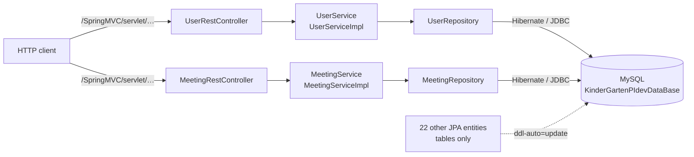

# SocialNetwork-ParentsKindergartens — Spring Boot backend

[Français](README.md) · **English**

Spring Boot REST backend of a social network connecting parents, kindergartens and their staff, built as a
team for the PIDEV integrated project (ESPRIT, 2021).

> The project vision and planned features are described in
> [Kindergarden_social_network](https://github.com/rachedchakchouk/Kindergarden_social_network).

## Overview

- Data model of the platform: 24 JPA entities and 10 enums (users and profiles, kindergarten life,
  communication, services). Details: [docs/DATA-MODEL.en.md](docs/DATA-MODEL.en.md).
- REST API implemented for two modules: users (`User`) and meetings (`Meeting`), each with list, read, create,
  update and delete.
- The other 22 entities have no repository, service or controller: they are used to create the tables.
- JUnit tests: Spring context startup and tests of the user and meeting services.

## Tech stack

Versions read from `SocialNetwork-ParentsKindergartens/pom.xml`,
`SocialNetwork-ParentsKindergartens/.mvn/wrapper/maven-wrapper.properties` and `.github/workflows/ci.yml`.

| Layer | Technology | Version |
|---|---|---|
| Language | Java | 8 (`java.version` = 1.8) |
| Framework | Spring Boot (Web, Data JPA) | 2.7.18 |
| Framework | Spring Framework | 5.3.39 (pinned in the pom) |
| Embedded server | Apache Tomcat | 9.0.123 (pinned in the pom) |
| Persistence | Hibernate ORM | managed by Spring Boot (5.6.15.Final according to the CI log) |
| Database | MySQL, `com.mysql:mysql-connector-j` driver | driver 8.4.0; MySQL 8.4 in CI |
| Other starters | Spring Web Services (declared, no SOAP endpoint in the code), DevTools (automatic restart during development) | managed by Spring Boot |
| Logging | Logback (Spring Boot); the services use the Log4j 2 API, routed to Logback | managed by Spring Boot |
| Tests | JUnit 5 (`spring-boot-starter-test`), JUnit 4 with `junit-vintage-engine` | managed by Spring Boot |
| Build | Maven, through the Maven Wrapper | Maven 3.6.3 |
| CI | GitHub Actions, Temurin JDK, MySQL service | JDK 8, `mysql:8.4` image |

## Architecture

Layered architecture: `entities` → `repositories` (Spring Data JPA) → `services` → `controls` (REST
controllers).



## Repository layout

The Maven project lives in a subfolder named after the repository.

```text
SocialNetwork-ParentsKindergartens/              # repository root
├── .github/
│   ├── dependabot.yml                           # Maven and GitHub Actions updates
│   └── workflows/ci.yml                         # CI: build and tests against MySQL
├── docs/DATA-MODEL.md                           # data model (and DATA-MODEL.en.md)
├── README.md, README.en.md
└── SocialNetwork-ParentsKindergartens/          # Maven project
    ├── .mvn/wrapper/, mvnw, mvnw.cmd            # Maven Wrapper (Maven 3.6.3)
    ├── pom.xml
    └── src/
        ├── main/java/se/pidev/
        │   ├── SocialNetworkParentsKindergartensApplication.java
        │   ├── controls/                        # UserRestController, MeetingRestController
        │   ├── entities/                        # 24 JPA entities and 10 enums
        │   ├── repositories/                    # UserRepository, MeetingRepository
        │   └── services/                        # UserService(Impl), MeetingService(Impl)
        ├── main/resources/application.properties
        └── test/java/se/pidev/                  # three test classes
```

## Prerequisites

- JDK 8 (CI uses Temurin 8). On Windows, `JAVA_HOME` must point to this JDK, otherwise `mvnw.cmd` stops.
- MySQL 8 on `localhost:3306`, with the `root` account and no password (the repository's configuration), or
  Docker to start the same MySQL as the CI.
- Git. Maven itself is not needed: the wrapper downloads Maven 3.6.3 (requires access to Maven Central).

## Local setup and run

Maven commands are run from the `SocialNetwork-ParentsKindergartens` subfolder.

Windows (PowerShell):

```powershell
git clone https://github.com/rachedchakchouk/SocialNetwork-ParentsKindergartens.git
cd SocialNetwork-ParentsKindergartens\SocialNetwork-ParentsKindergartens

# Optional: MySQL 8.4 as in CI (root, no password); wait until it is ready
docker run -d --name mysql-kindergarten -p 3306:3306 -e MYSQL_ALLOW_EMPTY_PASSWORD=yes mysql:8.4

.\mvnw.cmd spring-boot:run
```

Linux / macOS (`mvnw` is not marked executable in the repository: run it with `sh` or `chmod +x mvnw` first):

```bash
git clone https://github.com/rachedchakchouk/SocialNetwork-ParentsKindergartens.git
cd SocialNetwork-ParentsKindergartens/SocialNetwork-ParentsKindergartens
docker run -d --name mysql-kindergarten -p 3306:3306 -e MYSQL_ALLOW_EMPTY_PASSWORD=yes mysql:8.4   # optional
sh mvnw spring-boot:run
```

The application listens on port **8083**; every route is prefixed with `/SpringMVC/servlet`, for example
<http://localhost:8083/SpringMVC/servlet/retrieve-all-users>.

Executable JAR: `.\mvnw.cmd -B package -DskipTests` (or `sh mvnw -B package -DskipTests`) produces
`target/SocialNetwork-ParentsKindergartens-1.0.jar`, to run with
`java -jar target/SocialNetwork-ParentsKindergartens-1.0.jar`.

## Configuration

All the configuration is in `SocialNetwork-ParentsKindergartens/src/main/resources/application.properties`; no
Spring profile is defined.

| Key | Value in the repository | Purpose |
|---|---|---|
| `server.port` | `8083` | HTTP port |
| `server.servlet.context-path` | `/SpringMVC` | application path |
| `spring.mvc.servlet.path` | `/servlet` | `DispatcherServlet` path |
| `spring.datasource.url` | `jdbc:mysql://localhost:3306/KinderGartenPIdevDataBase?createDatabaseIfNotExist=true&…` | MySQL database, created if missing |
| `spring.datasource.username` | `root` | MySQL account |
| `spring.datasource.password` | empty | MySQL password |
| `spring.jpa.hibernate.ddl-auto` | `update` | schema created or updated at startup |
| `spring.jpa.show-sql` | `true` | SQL statements printed to the console |
| `spring.jpa.properties.hibernate.dialect` | `org.hibernate.dialect.MySQL5Dialect` | SQL dialect |
| `spring.mvc.view.prefix`, `spring.mvc.view.suffix` | `/views/`, `.jsp` | JSP views (none in the repository) |
| `logging.file.name` | `C:/spring_log_file.log` | log file (Windows path) |
| `logging.logback.rollingpolicy.max-file-size` | `100KB` | maximum size of a log file |
| `logging.level.root` | `INFO` | log level |

Any key can be overridden with an environment variable (Spring Boot convention). The log file is meant to sit
at the root of `C:`, which is often write-protected on Windows: set another path if needed.

```powershell
$env:SPRING_DATASOURCE_PASSWORD = "<password>"
$env:LOGGING_FILE_NAME = "logs/kindergarten.log"
.\mvnw.cmd spring-boot:run
```

```bash
export SPRING_DATASOURCE_PASSWORD='<password>'
export LOGGING_FILE_NAME=logs/kindergarten.log
sh mvnw spring-boot:run
```

On Linux and macOS, `C:/spring_log_file.log` is a path relative to the working directory.

## Database

- Engine: MySQL. The `KinderGartenPIdevDataBase` database is created on first startup
  (`createDatabaseIfNotExist=true`).
- Schema: generated by Hibernate (`ddl-auto=update`); no migration tool (Flyway, Liquibase) and no demo data.
- 24 tables prefixed with `t_` (`t_users`, `t_meetings`, `t_parents`, `t_kindergartens`…), with no JPA
  relationship between them, hence no foreign key. The `MySQL5Dialect` dialect creates them as MyISAM tables.

| Area | Entities |
|---|---|
| Users and profiles | `User`, `Parent`, `Staff`, `KindergartenOwner`, `Educator`, `Doctor`, `BusDriver` |
| Kindergarten life | `Kindergarten`, `Child`, `Course`, `Activity`, `Note`, `Club`, `Event` |
| Communication | `Meeting`, `Appointment`, `Notification`, `Chat`, `Forum`, `Post`, `Comment` |
| Services | `Path` (school bus routes), `Claim` (complaints), `Satisfaction` (satisfaction feedback) |

Attributes, columns and enums (including `Role`, a staff member's role):
[docs/DATA-MODEL.en.md](docs/DATA-MODEL.en.md).

## API

Base URL: `http://localhost:8083/SpringMVC/servlet`. No route is protected.

| Method | Path | Input | Response |
|---|---|---|---|
| GET | `/retrieve-all-users` | — | list of users |
| GET | `/retrieve-user/{user-id}` | ID | user (error 500 if it does not exist) |
| POST | `/add-user` | `User` JSON body | saved user |
| PUT | `/modify-user` | `User` JSON body with `user_Id` | saved user |
| DELETE | `/remove-user/{user-id}` | ID | — |
| GET | `/retrieve-all-meetings` | — | list of meetings |
| GET | `/retrieve-meeting/{meeting-id}` | ID | meeting (error 500 if it does not exist) |
| POST | `/add-meeting` | `Meeting` JSON body | saved meeting |
| PUT | `/modify-meeting` | `Meeting` JSON body with `meeting_Id` | saved meeting |
| DELETE | `/remove-meeting/{meeting-id}` | ID | — |

The update routes call the same save method (`save`) as creation: without an ID, they create a new record.
JSON keys follow the entities' accessors (`getUser_Email()` gives `user_Email`).

```bash
curl -X POST http://localhost:8083/SpringMVC/servlet/add-user \
  -H "Content-Type: application/json" \
  -d '{"user_Email":"parent@example.com","user_Password":"changeme"}'
curl -X POST http://localhost:8083/SpringMVC/servlet/add-meeting \
  -H "Content-Type: application/json" \
  -d '{"meeting_Topic":"Rentree","meeting_Duration":60,"meeting_Location":"Salle 1","meeting_Details":"Presentation","meeting_Date":"2021-09-15"}'
curl http://localhost:8083/SpringMVC/servlet/retrieve-all-meetings
```

```powershell
Invoke-RestMethod -Method Post -Uri http://localhost:8083/SpringMVC/servlet/add-user -ContentType "application/json" -Body '{"user_Email":"parent@example.com","user_Password":"changeme"}'
Invoke-RestMethod http://localhost:8083/SpringMVC/servlet/retrieve-all-users
```

## Tests

| Class | Kind | Needs |
|---|---|---|
| `SocialNetworkParentsKindergartensApplicationTests` | JUnit 5: Spring context startup | a reachable MySQL |
| `UserServiceImplTest` | JUnit 4 (`@RunWith(SpringRunner.class)`), run by the vintage engine: list, add, delete, update and read user no. 1 | a database in a specific state: the tests update or delete user no. 1 without creating it, and depend on execution order |
| `MeetingServiceImplTest` | JUnit 4, the same operations on meeting no. 1 | the same constraints |

Tests as the CI runs them (without the two data-dependent classes):

```powershell
.\mvnw.cmd -B verify "-Dtest=!UserServiceImplTest,!MeetingServiceImplTest" "-Dsurefire.failIfNoSpecifiedTests=false"
```

```bash
sh mvnw -B verify -Dtest='!UserServiceImplTest,!MeetingServiceImplTest' -Dsurefire.failIfNoSpecifiedTests=false
```

All tests, against a prepared database: `.\mvnw.cmd test` or `sh mvnw test`. The `junit-vintage-engine`
dependency is required: without it, the JUnit 5 platform would ignore the two JUnit 4 classes.

## Build, CI and deployment

The `.github/workflows/ci.yml` workflow ("CI"):

- runs on every push to `master` or `main` and on every pull request (including Dependabot's); a new run
  cancels the previous one on the same ref;
- "Back (Maven)" job on `ubuntu-latest` (25 minutes at most), run in the `SocialNetwork-ParentsKindergartens`
  subfolder, with a `mysql:8.4` service (`root` account, no password) and Temurin JDK 8 (Maven cache);
- runs `mvn -B verify -Dtest='!UserServiceImplTest,!MeetingServiceImplTest' -Dsurefire.failIfNoSpecifiedTests=false`:
  compilation, context startup test, then the executable JAR; `UserServiceImplTest` and `MeetingServiceImplTest`
  are excluded because the CI database is empty;
- on failure, the "Résumé des erreurs" step reports Maven errors and failing tests as annotations;
- publishes no artifact.

`.github/dependabot.yml` opens grouped updates for Maven dependencies (`/SocialNetwork-ParentsKindergartens`
folder) and GitHub Actions every Monday at 06:00 (Tunis time); major Spring Boot upgrades are excluded.

The repository has no Dockerfile and no deployment configuration.

## Security

- No Spring Security: every route is public; no CORS rule is defined.
- User passwords are stored in plain text (`user_password`) and returned by the read routes;
  `UserServiceImpl.retrieveAllUsers()` logs every user at INFO level, password included (`User.toString()`).
- No secret is committed: locally and in CI, MySQL is used with the `root` account and no password. For another
  account, provide the credentials through environment variables (see [Configuration](#configuration)).

## Team and author

PIDEV team project carried out at ESPRIT in 2021. The application code (entities, services, controllers, tests)
was committed to the repository on 28 March 2021 by Arij Mansour ("Project entities" commit); in 2026 Rached
Chakchouk added the documentation, the dependency upgrade and continuous integration.

**Rached Chakchouk** — Full Stack Software Engineer (Java / Spring Boot / Angular) ·
[LinkedIn](https://www.linkedin.com/in/rached-chakchouk) · [Portfolio](https://rached-chakchouk.netlify.app)
