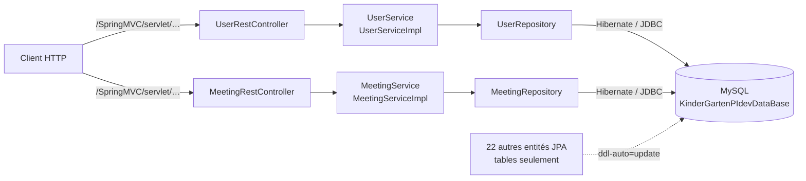

# SocialNetwork-ParentsKindergartens — back-end Spring Boot

**Français** · [English](README.en.md)

Back-end REST Spring Boot d'un réseau social qui relie les parents, les jardins d'enfants et leur personnel,
réalisé en équipe dans le cadre du projet intégré PIDEV (ESPRIT, 2021).

> La vision du projet et les fonctionnalités prévues sont décrites dans
> [Kindergarden_social_network](https://github.com/rachedchakchouk/Kindergarden_social_network).

## Aperçu

- Modèle de données de la plateforme : 24 entités JPA et 10 énumérations (utilisateurs et profils, vie du
  jardin d'enfants, communication, services). Détail : [docs/DATA-MODEL.md](docs/DATA-MODEL.md).
- API REST implémentée pour deux modules : utilisateurs (`User`) et réunions (`Meeting`), chacun avec liste,
  lecture, création, modification et suppression.
- Les 22 autres entités n'ont ni dépôt, ni service, ni contrôleur : elles servent à créer les tables.
- Tests JUnit : démarrage du contexte Spring et tests des services utilisateur et réunion.

## Stack technique

Versions lues dans `SocialNetwork-ParentsKindergartens/pom.xml`,
`SocialNetwork-ParentsKindergartens/.mvn/wrapper/maven-wrapper.properties` et `.github/workflows/ci.yml`.

| Couche | Technologie | Version |
|---|---|---|
| Langage | Java | 8 (`java.version` = 1.8) |
| Framework | Spring Boot (Web, Data JPA) | 2.7.18 |
| Framework | Spring Framework | 5.3.39 (fixée dans le pom) |
| Serveur embarqué | Apache Tomcat | 9.0.123 (fixée dans le pom) |
| Persistance | Hibernate ORM | gérée par Spring Boot (5.6.15.Final d'après le journal CI) |
| Base de données | MySQL, pilote `com.mysql:mysql-connector-j` | pilote 8.4.0 ; MySQL 8.4 en CI |
| Autres starters | Spring Web Services (déclaré, aucun point d'accès SOAP dans le code), DevTools (redémarrage automatique en développement) | gérées par Spring Boot |
| Journalisation | Logback (Spring Boot) ; les services utilisent l'API Log4j 2, redirigée vers Logback | gérées par Spring Boot |
| Tests | JUnit 5 (`spring-boot-starter-test`), JUnit 4 et moteur `junit-vintage-engine` | gérées par Spring Boot |
| Build | Maven, via le Maven Wrapper | Maven 3.6.3 |
| CI | GitHub Actions, JDK Temurin, service MySQL | JDK 8, image `mysql:8.4` |

## Architecture

Architecture en couches : `entities` → `repositories` (Spring Data JPA) → `services` → `controls`
(contrôleurs REST).



## Structure du dépôt

Le projet Maven se trouve dans un sous-dossier du même nom que le dépôt.

```text
SocialNetwork-ParentsKindergartens/              # racine du dépôt
├── .github/
│   ├── dependabot.yml                           # mises à jour Maven et GitHub Actions
│   └── workflows/ci.yml                         # CI : compilation et tests avec MySQL
├── docs/DATA-MODEL.md                           # modèle de données (et DATA-MODEL.en.md)
├── README.md, README.en.md
└── SocialNetwork-ParentsKindergartens/          # projet Maven
    ├── .mvn/wrapper/, mvnw, mvnw.cmd            # Maven Wrapper (Maven 3.6.3)
    ├── pom.xml
    └── src/
        ├── main/java/se/pidev/
        │   ├── SocialNetworkParentsKindergartensApplication.java
        │   ├── controls/                        # UserRestController, MeetingRestController
        │   ├── entities/                        # 24 entités JPA et 10 énumérations
        │   ├── repositories/                    # UserRepository, MeetingRepository
        │   └── services/                        # UserService(Impl), MeetingService(Impl)
        ├── main/resources/application.properties
        └── test/java/se/pidev/                  # trois classes de test
```

## Prérequis

- JDK 8 (la CI utilise Temurin 8). Sous Windows, `JAVA_HOME` doit pointer vers ce JDK : `mvnw.cmd` s'arrête
  sinon.
- MySQL 8 sur `localhost:3306`, avec le compte `root` sans mot de passe (configuration du dépôt), ou Docker
  pour lancer le même MySQL que la CI.
- Git. Maven n'est pas nécessaire : le wrapper télécharge Maven 3.6.3 (accès à Maven Central requis).

## Installation et lancement en local

Les commandes Maven se lancent depuis le sous-dossier `SocialNetwork-ParentsKindergartens`.

Windows (PowerShell) :

```powershell
git clone https://github.com/rachedchakchouk/SocialNetwork-ParentsKindergartens.git
cd SocialNetwork-ParentsKindergartens\SocialNetwork-ParentsKindergartens

# Facultatif : MySQL 8.4 comme en CI (root sans mot de passe) ; attendez qu'il soit prêt
docker run -d --name mysql-kindergarten -p 3306:3306 -e MYSQL_ALLOW_EMPTY_PASSWORD=yes mysql:8.4

.\mvnw.cmd spring-boot:run
```

Linux / macOS (`mvnw` n'est pas marqué exécutable dans le dépôt : lancez-le avec `sh` ou faites `chmod +x mvnw`) :

```bash
git clone https://github.com/rachedchakchouk/SocialNetwork-ParentsKindergartens.git
cd SocialNetwork-ParentsKindergartens/SocialNetwork-ParentsKindergartens
docker run -d --name mysql-kindergarten -p 3306:3306 -e MYSQL_ALLOW_EMPTY_PASSWORD=yes mysql:8.4   # facultatif
sh mvnw spring-boot:run
```

L'application écoute sur le port **8083** ; toutes les routes sont préfixées par `/SpringMVC/servlet`, par
exemple <http://localhost:8083/SpringMVC/servlet/retrieve-all-users>.

JAR exécutable : `.\mvnw.cmd -B package -DskipTests` (ou `sh mvnw -B package -DskipTests`) produit
`target/SocialNetwork-ParentsKindergartens-1.0.jar`, à lancer avec
`java -jar target/SocialNetwork-ParentsKindergartens-1.0.jar`.

## Configuration

Toute la configuration se trouve dans `SocialNetwork-ParentsKindergartens/src/main/resources/application.properties` ;
aucun profil Spring n'est défini.

| Clé | Valeur dans le dépôt | Rôle |
|---|---|---|
| `server.port` | `8083` | port HTTP |
| `server.servlet.context-path` | `/SpringMVC` | chemin de l'application |
| `spring.mvc.servlet.path` | `/servlet` | chemin du `DispatcherServlet` |
| `spring.datasource.url` | `jdbc:mysql://localhost:3306/KinderGartenPIdevDataBase?createDatabaseIfNotExist=true&…` | base MySQL, créée si elle n'existe pas |
| `spring.datasource.username` | `root` | compte MySQL |
| `spring.datasource.password` | vide | mot de passe MySQL |
| `spring.jpa.hibernate.ddl-auto` | `update` | schéma créé ou mis à jour au démarrage |
| `spring.jpa.show-sql` | `true` | requêtes SQL affichées dans la console |
| `spring.jpa.properties.hibernate.dialect` | `org.hibernate.dialect.MySQL5Dialect` | dialecte SQL |
| `spring.mvc.view.prefix`, `spring.mvc.view.suffix` | `/views/`, `.jsp` | vues JSP (aucune dans le dépôt) |
| `logging.file.name` | `C:/spring_log_file.log` | fichier de journal (chemin Windows) |
| `logging.logback.rollingpolicy.max-file-size` | `100KB` | taille maximale d'un fichier de journal |
| `logging.level.root` | `INFO` | niveau de journalisation |

Toute clé peut être remplacée par une variable d'environnement (convention Spring Boot). Le fichier de journal
est prévu à la racine de `C:`, souvent protégée en écriture sous Windows : indiquez au besoin un autre chemin.

```powershell
$env:SPRING_DATASOURCE_PASSWORD = "<mot de passe>"
$env:LOGGING_FILE_NAME = "logs/kindergarten.log"
.\mvnw.cmd spring-boot:run
```

```bash
export SPRING_DATASOURCE_PASSWORD='<mot de passe>'
export LOGGING_FILE_NAME=logs/kindergarten.log
sh mvnw spring-boot:run
```

Sous Linux et macOS, `C:/spring_log_file.log` est un chemin relatif au répertoire de lancement.

## Base de données

- Moteur : MySQL. La base `KinderGartenPIdevDataBase` est créée au premier démarrage
  (`createDatabaseIfNotExist=true`).
- Schéma : généré par Hibernate (`ddl-auto=update`) ; aucun outil de migration (Flyway, Liquibase) et aucune
  donnée de démonstration.
- 24 tables préfixées `t_` (`t_users`, `t_meetings`, `t_parents`, `t_kindergartens`…), sans relation JPA entre
  elles, donc sans clé étrangère. Le dialecte `MySQL5Dialect` les crée en MyISAM.

| Domaine | Entités |
|---|---|
| Utilisateurs et profils | `User`, `Parent`, `Staff`, `KindergartenOwner`, `Educator`, `Doctor`, `BusDriver` |
| Vie du jardin d'enfants | `Kindergarten`, `Child`, `Course`, `Activity`, `Note`, `Club`, `Event` |
| Communication | `Meeting`, `Appointment`, `Notification`, `Chat`, `Forum`, `Post`, `Comment` |
| Services | `Path` (trajets du bus scolaire), `Claim` (réclamations), `Satisfaction` (avis de satisfaction) |

Attributs, colonnes et énumérations (dont `Role`, rôle d'un membre du personnel) :
[docs/DATA-MODEL.md](docs/DATA-MODEL.md).

## API

URL de base : `http://localhost:8083/SpringMVC/servlet`. Aucune route n'est protégée.

| Méthode | Chemin | Entrée | Réponse |
|---|---|---|---|
| GET | `/retrieve-all-users` | — | liste des utilisateurs |
| GET | `/retrieve-user/{user-id}` | identifiant | utilisateur (erreur 500 s'il n'existe pas) |
| POST | `/add-user` | corps JSON `User` | utilisateur enregistré |
| PUT | `/modify-user` | corps JSON `User` avec `user_Id` | utilisateur enregistré |
| DELETE | `/remove-user/{user-id}` | identifiant | — |
| GET | `/retrieve-all-meetings` | — | liste des réunions |
| GET | `/retrieve-meeting/{meeting-id}` | identifiant | réunion (erreur 500 si elle n'existe pas) |
| POST | `/add-meeting` | corps JSON `Meeting` | réunion enregistrée |
| PUT | `/modify-meeting` | corps JSON `Meeting` avec `meeting_Id` | réunion enregistrée |
| DELETE | `/remove-meeting/{meeting-id}` | identifiant | — |

Les routes de modification appellent la même méthode d'enregistrement (`save`) que la création : sans
identifiant, elles créent un nouvel enregistrement. Les clés JSON suivent les accesseurs des entités
(`getUser_Email()` donne `user_Email`).

```bash
curl -X POST http://localhost:8083/SpringMVC/servlet/add-user \
  -H "Content-Type: application/json" \
  -d '{"user_Email":"parent@example.com","user_Password":"changeme"}'
curl -X POST http://localhost:8083/SpringMVC/servlet/add-meeting \
  -H "Content-Type: application/json" \
  -d '{"meeting_Topic":"Rentree","meeting_Duration":60,"meeting_Location":"Salle 1","meeting_Details":"Presentation","meeting_Date":"2021-09-15"}'
curl http://localhost:8083/SpringMVC/servlet/retrieve-all-meetings
```

```powershell
Invoke-RestMethod -Method Post -Uri http://localhost:8083/SpringMVC/servlet/add-user -ContentType "application/json" -Body '{"user_Email":"parent@example.com","user_Password":"changeme"}'
Invoke-RestMethod http://localhost:8083/SpringMVC/servlet/retrieve-all-users
```

## Tests

| Classe | Nature | Besoins |
|---|---|---|
| `SocialNetworkParentsKindergartensApplicationTests` | JUnit 5 : démarrage du contexte Spring | un MySQL accessible |
| `UserServiceImplTest` | JUnit 4 (`@RunWith(SpringRunner.class)`), exécuté par le moteur vintage : liste, ajout, suppression, modification et lecture de l'utilisateur n° 1 | une base dans un état précis : les tests modifient ou suppriment l'utilisateur n° 1 sans l'avoir créé, et dépendent de l'ordre d'exécution |
| `MeetingServiceImplTest` | JUnit 4, mêmes opérations sur la réunion n° 1 | mêmes contraintes |

Tests tels que les lance la CI (sans les deux classes dépendantes des données) :

```powershell
.\mvnw.cmd -B verify "-Dtest=!UserServiceImplTest,!MeetingServiceImplTest" "-Dsurefire.failIfNoSpecifiedTests=false"
```

```bash
sh mvnw -B verify -Dtest='!UserServiceImplTest,!MeetingServiceImplTest' -Dsurefire.failIfNoSpecifiedTests=false
```

Tous les tests, sur une base préparée : `.\mvnw.cmd test` ou `sh mvnw test`. Le moteur `junit-vintage-engine`
est indispensable : sans lui, la plateforme JUnit 5 ignorerait les deux classes JUnit 4.

## Build, CI et déploiement

Le workflow `.github/workflows/ci.yml` (« CI ») :

- se déclenche à chaque push sur `master` ou `main` et à chaque pull request (y compris celles de Dependabot) ;
  un nouveau run annule le précédent sur la même référence ;
- job « Back (Maven) » sur `ubuntu-latest` (25 minutes au plus), exécuté dans le sous-dossier
  `SocialNetwork-ParentsKindergartens`, avec un service `mysql:8.4` (compte `root` sans mot de passe) et le JDK
  Temurin 8 (cache Maven) ;
- lance `mvn -B verify -Dtest='!UserServiceImplTest,!MeetingServiceImplTest' -Dsurefire.failIfNoSpecifiedTests=false` :
  compilation, test de démarrage du contexte, puis JAR exécutable ; `UserServiceImplTest` et
  `MeetingServiceImplTest` sont exclus car la base de la CI est vide ;
- en cas d'échec, l'étape « Résumé des erreurs » remonte les erreurs Maven et les tests en échec sous forme
  d'annotations ;
- ne publie aucun artefact.

`.github/dependabot.yml` propose chaque lundi à 06:00 (heure de Tunis) des mises à jour groupées des
dépendances Maven (dossier `/SocialNetwork-ParentsKindergartens`) et des actions GitHub ; les montées de version
majeure de Spring Boot sont exclues.

Le dépôt ne contient ni Dockerfile ni configuration de déploiement.

## Sécurité

- Pas de Spring Security : toutes les routes sont publiques ; aucune règle CORS n'est définie.
- Les mots de passe des utilisateurs sont stockés en clair (`user_password`) et renvoyés par les routes de
  lecture ; `UserServiceImpl.retrieveAllUsers()` journalise chaque utilisateur au niveau INFO, mot de passe
  compris (`User.toString()`).
- Aucun secret n'est versionné : en local comme en CI, MySQL est utilisé avec le compte `root` sans mot de
  passe. Pour un autre compte, fournissez les identifiants par variables d'environnement (voir
  [Configuration](#configuration)).

## Équipe et auteur

Projet d'équipe PIDEV réalisé à ESPRIT en 2021. Le code de l'application (entités, services, contrôleurs,
tests) a été versé dans le dépôt le 28 mars 2021 par Arij Mansour (commit « Project entities ») ; Rached
Chakchouk a ajouté en 2026 la documentation, la mise à jour des dépendances et l'intégration continue.

**Rached Chakchouk** — ingénieur logiciel Full Stack (Java / Spring Boot / Angular) ·
[LinkedIn](https://www.linkedin.com/in/rached-chakchouk) · [Portfolio](https://rached-chakchouk.netlify.app)
